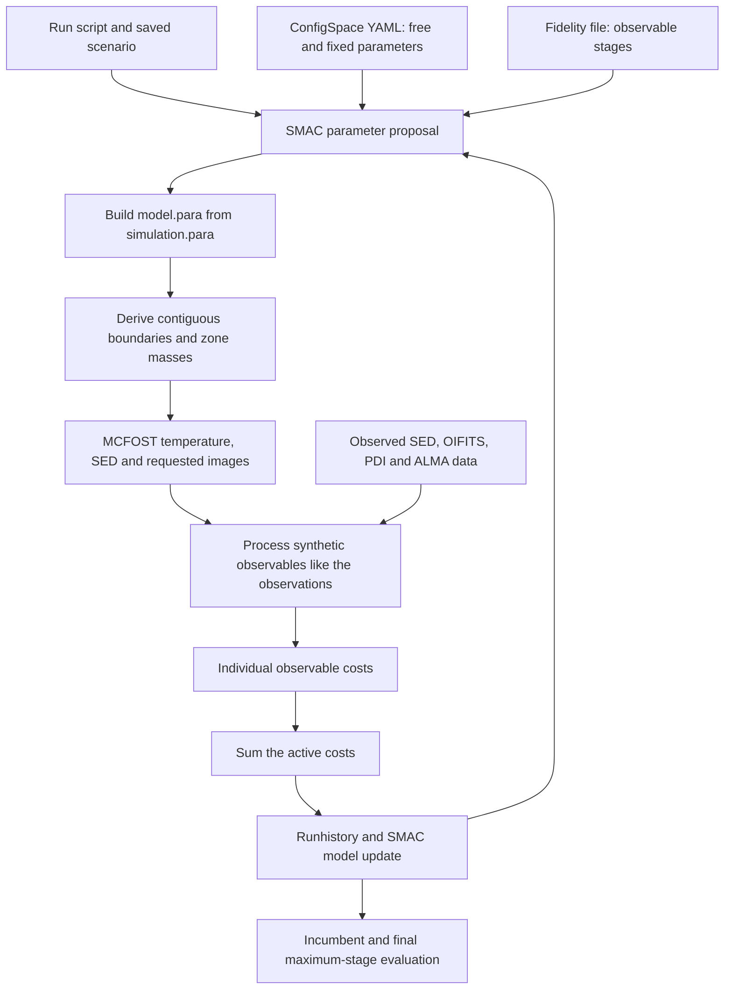

# Code and optimisation map for the research paper

The framework searches for a two-zone MCFOST circumbinary-disc model that reproduces the SED, infrared interferometry, SPHERE polarimetry and ALMA continuum image. Think of it as four connected layers: **physical assumptions → radiative transfer → observable comparisons → parameter search**. The optimisation returns a best configuration under a composite score; it does not by itself produce a posterior distribution.

## The complete workflow

There are two independent configuration questions. The physical YAML specifies **which discs can be proposed**. The fidelity file specifies **which observations judge each evaluation**. The MCFOST template supplies physical and numerical settings that the YAML does not override. The launch script activates ties, continuity, optional corrections and search controls.

## Where each responsibility lives

Paths below are relative to `modelling_optimisation/`.

| File | Responsibility | Read first |
|---|---|---|
| `SMAC3.py` | Loads observations and ConfigSpace, creates the scenario, dispatches trials and saves the incumbent | `main`, `objective`, `load_data`, `warmstart_from_runhistory_json` |
| `lib/obriy_fidelity.py` | Validates named observable stages and maps budgets to stages | `load_fidelity_config`, `map_budget_to_fidelity` |
| `lib/obriy_mcfost.py` | Edits the template, derives physical parameters, runs MCFOST and combines scores | `write_mcfost_paramfile`, `_2zone_cont_calc_dmass`, `run_mcfost`, `load_and_score_outputs` |
| `lib/obriy_sed.py` | Compares photometry with the reddened synthetic SED, including a companion component | `chi2_SED_with_reddening`, `fit_sed_reddening` |
| `lib/obriy_interferometry_data.py` | Loads the interferometric datasets required by the active products | Dataset loaders |
| `lib/obriy_interferometry.py` | Converts images into interferometric observables and evaluates residuals | `monochromatic_chi`, `chromatic_chi`, `oi_container_chi2` |
| `lib/obriy_polarimetry.py` | Processes polarised images and measures fraction, radial shape and differential sectors | `measure_pdi_constraints`, `compare_pdi_constraints`, `pdi_constraint_loss` |
| `lib/obriy_alma.py` | Matches the continuum image geometry and beam, then compares images | `compare_alma_images` |
| `lib/obriy_after_optimisation.py` | Supports inspection and analysis after the search | Check the analysis used for the selected run |
| `scripts/` and notebooks | Standalone calculations and diagnostic experiments | Distinguish these from the objective called by SMAC |
| `manual/warmstart_and_continuation.md` | Explains imported histories versus restoration of saved optimiser state | Both workflows |

The executable implementation is the authority for the objective. Some comments and diagnostic names still refer to older scores.

## The physical model

With `--2ZONE_CONT_LHC`, the sampled total dust mass and transition radius determine both zone masses and their common boundary:

\[
R_{\mathrm{out},1}=R_{\mathrm{in},2}=R_m,
\qquad M_1+M_2=M_{\mathrm{dust}}.
\]

The mass split enforces surface-density continuity, rather than fitting independent zone masses. Set \(x=r/R_m\) and let \(s_1,s_2\) denote the code's surface-density exponents. The profiles used for the mass calculation are

\[
\Sigma_1(r)=\Sigma_m x^{s_1},
\]

and, for the tapered outer zone,

\[
\Sigma_2(r)=\Sigma_m x^{s_2}
\exp\left[-(r/R_c)^q+(R_m/R_c)^q\right],
\qquad q=2+\texttt{zone\_2\_-gamma\_exp}.
\]

For a power-law outer zone, omit the exponential. The additive boundary term ensures both profiles equal \(\Sigma_m\) at \(R_m\). Integrating \(2\pi r\Sigma\) gives dimensionless integrals \(I_1,I_2\), and the implementation sets \(M_i=M_{\mathrm{dust}}I_i/(I_1+I_2)\). Radii are in au and dust masses in solar masses. These equations describe the current continuity implementation; historical effective `model.para` files establish what individual trials actually used.

Shared heights and flaring exponents, together with equal reference radii, give the same prescribed \(H(r)\) across the boundary. `--share-zone-composition` copies the entire zone 1 dust population to zone 2. Dust settling is a separate physical prescription; the tapered experiment branches are named `dubrulle` and `fromang`.

## The simulation families

The requested roots are `smac/1_akke_2zones_wider/` and `smac/1_akke_2zones_wider_tapered/`.

| Family | Organisation | Interpretation |
|---|---|---|
| `1_akke_2zones_wider` | SED, SED plus interferometry, SED plus PDI, SED plus ALMA, and joint experiments; also `dubrulle_not_tapered_by_mistake` | Several observable selections and a branch explicitly labelled as an unintended non-tapered model |
| `1_akke_2zones_wider_tapered` | `dubrulle/` and `fromang/`, each with SED, SED plus interferometry, SED plus PDI, SED plus ALMA, staged joint and direct joint experiments | Outer taper and settling prescription are organised separately from observable selection |

Folder names identify experiments, but the model type comes from the YAML plus `simulation.para`, and the effective trial file is `trials/config_<id>_budget_<value>.../model.para`.

The inspected tapered `fromang/sed_interf_pdi_alma_stages/fidelity.txt` specifies:

| Stage | Budget under default eta of 3 | Active products |
|---|---:|---|
| `sed` | 1 | SED |
| `sed-interf` | 3 | SED and interferometry with one image per band |
| `all` | 9 | SED, interferometry, V/I/H PDI and ALMA |

Its `sed_interf_pdi_alma_full_all` counterpart specifies a single `all` stage, so its budget is 1. A budget of 1 therefore has different meanings in different runs. Compare scores only when their active observables and scoring settings agree.

The inspected tapered staged launch script requests seed 185127, 2000 total trials, 10 workers, continuity, shared composition and intermediate plots. Requested trials are a search limit, not evidence of completed evaluations or 2000 unique discs.

### Representative parameter differences

These are the inspected configurations, not universal settings for every subfolder:
`1_akke_2zones_wider/sed_interf_pdi_alma_full_all/configuration_akke_2zones.yaml` and
`1_akke_2zones_wider_tapered/fromang/sed_interf_pdi_alma_stages/configuration_tapered.yaml`.

| Parameter | Wider joint configuration | Tapered Fromang staged configuration |
|---|---|---|
| Total dust mass | Four categorical values, 10^-4 to 10^-1 solar masses | Continuous logarithmic range, 10^-4 to 10^-1 solar masses |
| Transition radius | 10–40 au | 10–40 au |
| Taper radius | Not specified in this YAML | Integer 60–250 au |
| Inner density exponent | 1–2 | 0.5–4 |
| Outer density exponent | -2 to -0.5 | -4 to -0.5 |
| Taper exponent field | Not specified in this YAML | -1.9 to -0.1 |
| Inclination | Continuous 0–50 degrees | Integer 0–50 degrees |
| Position angle | Continuous 90–180 degrees | Integer 0–180 degrees |
| Minimum grain size | 0.1 micrometres | 0.01 micrometres |
| Settling selector | 2 | 3 |
| Additional forbidden relation | None | Inner density exponent must exceed the flaring exponent |

Both inspected configurations fix distance to 1220 pc, inner radius to 7.2 au and outer radius to 300 au. They sample scale height, flaring, grain-size exponent, porosity, a grain-shape parameter and iron fraction. Because several dimensions change together, this pair cannot isolate the effect of tapering alone.

## What SMAC minimises

The current scorer returns the sum of the active terms:

\[
J=J_{\mathrm{SED}}+\sum_b J_{\mathrm{interf},b}
+\sum_k J_{\mathrm{PDI},k}+J_{\mathrm{ALMA}}.
\]

Inactive observables contribute no term. The individual terms are stored in `additional_info`, which is essential for diagnosing tradeoffs.

| Observable | Current cost | Scientific interpretation |
|---|---|---|
| SED | Uncertainty-weighted squared residuals normalised by N−1, with fitted reddening | Photometric fit statistic; N−1 is the implemented normalisation, not a complete joint degrees-of-freedom calculation |
| Interferometry | Sum of per-instrument N−1-normalised chi-square terms | Each instrument contributes separately; the objective does not pool all points into one reduced chi-square |
| PDI | Weighted squared differences in polarised fraction, radial profile and six differential-sector measurements | Empirical morphology and flux-fraction score without uncertainty divisors |
| ALMA | 100 times residual image energy divided by observed image energy inside the comparison aperture | Relative image discrepancy, rather than pixel chi-square |

For each PDI band,

\[
J_{\mathrm{PDI}}=10^5(\Delta f)^2
+10^4\operatorname{mean}_j[(\Delta p_j)^2]
+5\times10^3\sum_{\ell=1}^{6}(\Delta d_\ell)^2.
\]

The observed positive-Qphi fraction clips the numerator to positive values; the radial shape retains signed Qphi. The intensity profile and other image diagnostics should not be mistaken for scored terms. The executable PDI calculation sums these weighted terms despite stale metadata mentioning a mean.

One-image-per-band interferometry generates images at 1.65, 2.2, 3.5 and 10 micrometres. PIONIER, GRAVITY and MATISSE L use squared visibilities; MATISSE N uses visibility amplitudes. The product name `vis2_1perband` therefore does not describe every residual type. Chromatic interferometry is a separate option. PDI images are generated at 0.55, 0.82 and 1.63 micrometres. ALMA image geometry and wavelength come from observation metadata.

## The optimisation approach

`SMAC3.py` uses `MultiFidelityFacade` and its intensifier, with eta from the fidelity configuration. The search proposes mixed continuous, integer and categorical configurations and uses evaluation history to guide later proposals. Multiple-stage runs allow configurations to be evaluated and promoted through increasingly expensive observable combinations. Direct joint runs evaluate the full objective immediately.

In the current implementation, **fidelity means observable selection**. Budgets are assigned as \(\eta^i\). The photon-setting assignments in `write_mcfost_paramfile` are commented out; the current stage mapping does not implement photon counts increasing with budget. Numerical MCFOST settings come from the template and explicit image geometry. Historical comments about photon scaling are insufficient support for a paper claim.

Adding observations also changes the objective itself. Early SED rankings need not agree with final joint rankings. This is a useful staged search strategy, but the assumption that early stages preserve promising joint models should be assessed by comparing staged and direct joint searches under matched physical settings.

The scenario declares `deterministic=False`, recognising a potentially stochastic objective. This declaration does not establish repeated-run uncertainty analysis or control the MCFOST seed. Execution failures caught around `run_mcfost` return a penalty of 10^99 with failure details; other failure paths need their recorded status inspected separately.

Warmstarting imports compatible historical evaluations into a new optimiser. Saved-state continuation restores the existing run. Configuration IDs may change during warmstart; compare physical parameter values when matching models across runs.

## Paragraph for the Methods section

We optimised two-zone MCFOST disc models using the SMAC3 multi-fidelity framework. The search space comprised continuous, integer and categorical physical parameters, while fixed assumptions were supplied by the configuration and MCFOST template. For runs using the continuity construction, the transition radius defined a common zone boundary and the total dust mass was partitioned to preserve surface-density continuity. Synthetic photometric, interferometric, polarimetric and millimetre observables were compared with the corresponding observations using a composite objective. This objective combined uncertainty-weighted photometric and interferometric residual terms with empirical polarimetric constraints and an ALMA residual-energy term. The tapered staged experiments introduced constraints through SED-only, SED-plus-interferometry and full-observable stages; direct joint experiments used all selected constraints from the first evaluation. The selected configuration minimised the adopted objective within the explored search space.

Use the staged sentence only for the corresponding experiments. Add the selected run's completed evaluation counts, software versions, template settings and repeat-run results before reporting a final Methods description.

## Evidence needed for paper conclusions

1. Identify the production branch and record its effective template, parameter space, stage manifest, command-line options and software versions. Current source describes current behaviour; historical runs may have used earlier code.
2. Report completed evaluations by stage, unique configurations, optimiser seeds and failures from `runhistory.json`, rather than quoting requested trial limits.
3. Show SED, interferometric, individual PDI and ALMA costs for the final selected models. A smaller total alone does not establish an adequate fit to every dataset.
4. Compare physical alternatives under matched bounds and observable definitions. Include direct joint versus staged optimisation when assessing early-stage screening.
5. Distinguish optimiser variability, Monte Carlo radiative-transfer noise and observational uncertainty. Corner plots of optimiser samples or inverse-cost weights describe the sampled ensemble; they are not automatically calibrated credible intervals.
6. Describe the score as a composite objective. The code's printed label “Total reduced chi2” and partial log-likelihood bookkeeping do not turn the image terms into a joint likelihood.

## How to navigate one run

Read `run_smac.q` for flags, `configuration*.yaml` for parameter choices and `simulation.para` for remaining assumptions. Then read `fidelity.txt` and `fidelity_resolved.json` for the objective schedule. Under `optimization/<seed>/`, `scenario.json` records the search setup and `runhistory.json` connects sampled configurations to budgets, scores, statuses and additional information. Use those records to locate a trial, inspect its effective `model.para`, MCFOST logs and synthetic observables, and compare its individual cost terms. The incumbent is the selected configuration; its final evaluation should be checked against the observational diagnostics before interpreting it scientifically.

Source anchors: `SMAC3.py:161,720,886`; `lib/obriy_fidelity.py:8`; `lib/obriy_mcfost.py:657,725,884,980,1708`; `lib/obriy_polarimetry.py:3723,3824`; `lib/obriy_alma.py:598,675`. Existing `paper/modelling_source_notes.md` contains complementary manuscript and uncertainty caveats.
